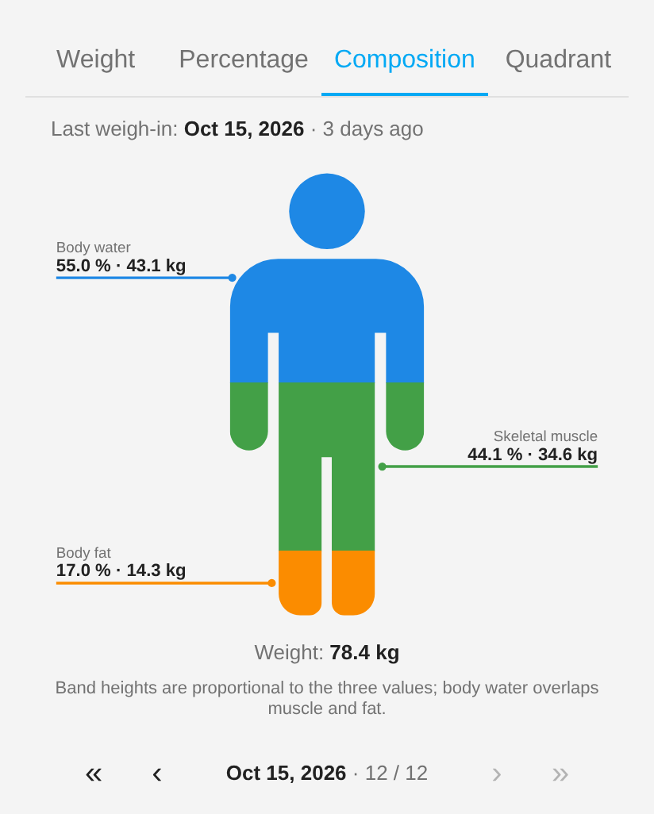
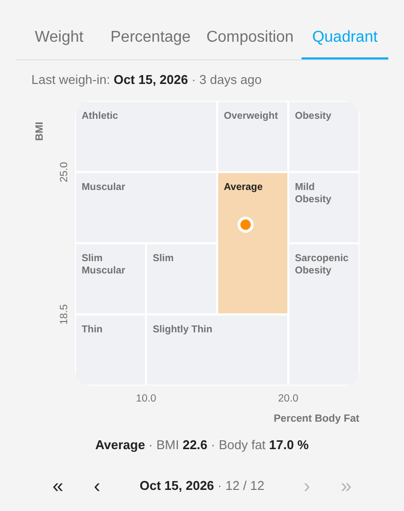
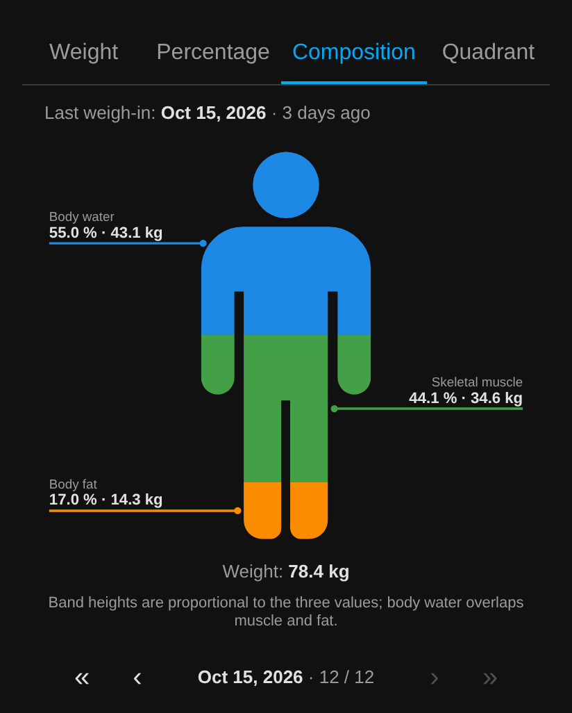
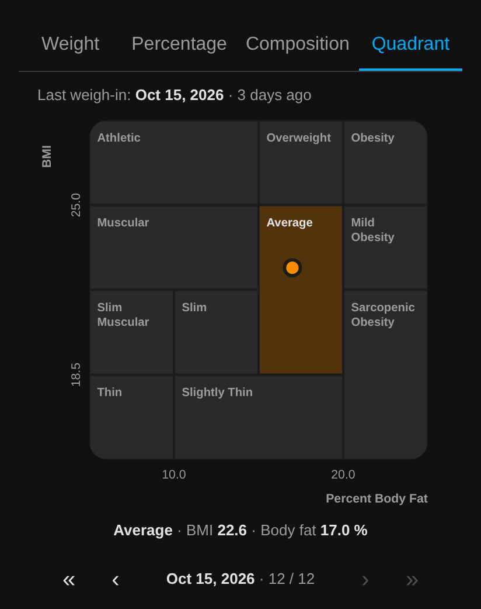

# HA InBody for Home Assistant

Custom integration (HACS) that brings your **InBody** scale measurements into Home Assistant, the latest one and your whole history: weight, BMI, body fat, skeletal muscle, body water and more, with a ready-made Lovelace card. It works with any InBody scale that syncs to the InBody app.

> **Disclaimer:** InBody has no public API for personal use. This integration uses the InBody mobile app's API, reverse-engineered by [rwestergren/inbody-api-mcp](https://github.com/rwestergren/inbody-api-mcp) (MIT). It is **unofficial** and may stop working if InBody changes the app or its servers. Use it at your own risk.

## How it works

The scale syncs each measurement to the InBody cloud (through Wi-Fi and the app). Home Assistant logs in to your account in the cloud and checks for the latest measurement every 30 minutes (configurable); it can also import all your past measurements (see [Importing history](#importing-history)). There is no direct communication with the scale.

As a result, a measurement only shows up in Home Assistant **after** it has reached the InBody app.

## Installation (HACS)

[](https://my.home-assistant.io/redirect/hacs_repository/?owner=jacardbr&repository=ha-inbody&category=integration)

1. Publish this folder as a GitHub repository (`hacs.json` and `custom_components/` must be at the repository root).
2. Click the **Open HACS repository on My Home Assistant** button above. It opens this repository directly in the HACS of your instance (the first time, the site asks for your Home Assistant address). Or do it manually: **HACS → ⋮ → Custom repositories**, paste `https://github.com/jacardbr/ha-inbody`, category **Integration**, then **Add**.
3. Search for **HA InBody** in HACS and download it.
4. **Restart Home Assistant.** With Docker: `docker restart <container-name>`. No volume changes are needed: HACS writes to `/config/custom_components/ha_inbody`, which is already inside your `/config` volume.
5. Go to **Settings → Devices & services → Add integration → HA InBody**.

Manual installation (without HACS): copy `custom_components/ha_inbody` to `<your /config>/custom_components/ha_inbody` and restart.

## Configuration

| Field | What to enter |
|---|---|
| Login ID (phone number) | The **phone number** used to register in the InBody app: digits only, no country code and no `+`. Email does not work. |
| Password | Your InBody app password. |
| Country | 2-letter ISO code (`US`, `BR`, …). The default is `US`. |
| Import past measurements after setup | Checked by default. Fetches your whole history once, in the background (see [Importing history](#importing-history)). |

After setup, click **Configure** on the integration. A menu offers **Change update interval** (5 to 1440 minutes) and **Import history now**.

## Entities

| Entity | Unit |
|---|---|
| Weight | kg |
| BMI | kg/m² |
| Body fat percentage | % |
| Skeletal muscle mass | kg |
| Skeletal muscle percentage | % |
| Body fat mass | kg |
| Body water mass | kg |
| Body water percentage | % |
| Last scan | date/time |

The **skeletal muscle percentage** and **body water percentage** sensors are calculated by the integration (mass ÷ weight × 100); the API does not provide them. Body fat percentage comes straight from the API.

Entity IDs are generated when an entity is first created (for example `sensor.inbody_weight`) and Home Assistant keeps them afterwards. If you installed an earlier version while Home Assistant was set to another language, your existing entities keep their old IDs; you can rename them under **Settings → Devices & services → Entities**.

### Additional metrics

The API returns more fields than the sensors above. Every other **numeric** field of the scan (for example intracellular and extracellular water, protein, minerals, fat-free mass, basal metabolic rate, visceral fat level, waist-hip ratio, or any segmental values) is exposed as an extra sensor.

- Four of them are **enabled by default**: **InBody score**, **Visceral fat level**, **Waist-hip ratio** and **Basal metabolic rate**. All the other extra sensors are **disabled by default**, so your entity list is not flooded. If you installed an earlier version, those four were created disabled; enable them by hand. Enable the ones you want under **Settings → Devices & services → HA InBody → entities** (the disabled ones are listed there; select one and enable it).
- They are discovered from your own data: the integration looks at the fields the API actually returns for your account, and adds a sensor when a new field shows up in a later scan.
- Well-known InBody abbreviations get a readable name and unit (for example `ICW` → **Intracellular water**, kg; `BMR` → **Basal metabolic rate**, kcal). Any other field keeps its raw name, for example **BCA XYZ**, with no unit; you can rename it in the entity settings.
- Fields nested inside other fields are flattened (for example `BCA SEG.RA`). Lists, text, dates and identifiers are ignored.
- When you run the history import, the extra sensors you have enabled are included too.

The **Last scan** entity also exposes, as the `bca` and `mfa` attributes, **every** field returned by the API, including non-numeric ones. To discover the exact field names of your account: **Settings → Devices & services → InBody → ⋮ → Download diagnostics** (the password and phone number are redacted). A field can also be read with a template, for example:

```yaml
template:
  - sensor:
      - name: "InBody example field"
        state: "{{ state_attr('sensor.inbody_last_scan', 'bca')['FIELD_NAME'] }}"
```

(Adjust the `entity_id` to the one shown in your Home Assistant.)

## Importing history

By default the integration only sees the latest measurement from the moment it is installed. To bring in **all past measurements** of your InBody account, leave **Import past measurements after setup** checked when adding the integration. The import runs once, in the background, and the option unchecks itself when it finishes successfully. If it fails (for example, no internet), it is retried the next time the integration loads.

To import at any time, go to **Settings → Devices & services → HA InBody → Configure**, choose **Import history now** and confirm. When it finishes, Home Assistant shows how many scans were found and how many points were written.

Another way, handy for automations, is the `ha_inbody.import_history` action:

1. **Developer tools → Actions**.
2. Choose **HA InBody: Import history** (`ha_inbody.import_history`).
3. Optional: choose the account; leaving it empty imports every configured account.
4. **Perform action**. The response shows how many scans were found and how many points were written per sensor.

What it does: it fetches every measurement from the cloud and writes **hourly long-term statistics** for the weight, BMI, body fat percentage, skeletal muscle, body fat mass and body water sensors, plus any enabled [extra metric](#additional-metrics) sensor. The past points show up in statistics graphs, for example:

```yaml
type: statistics-graph
title: Weight
entities:
  - sensor.inbody_weight   # adjust to your entity_id
stat_types:
  - mean
period: month
days_to_show: 730
```

Details:

- The sensors must already exist, so run the action after the integration is configured.
- It is safe to run again: the same hours are overwritten with the same values.
- If there are two measurements in the same hour, the last one wins.
- Past measurements show up in **statistics graphs**, not in the **History** card (which shows recorded states, not statistics).
- The import uses the recorder statistics API, which changed in recent Home Assistant versions. If the action complains about the version, update Home Assistant.

## Lovelace card

The integration ships a ready-to-use card with four tabs:

- **Weight**: weight, skeletal muscle mass, body fat mass and body water mass, in kg.
- **Percentage**: body fat, skeletal muscle and body water, in %.
- **Composition**: a body map cut into bands: **body water (blue)**, **skeletal muscle (green)** and **body fat (orange)**, each with its percentage and kg. The band heights are proportional to the three values; because body water overlaps muscle and fat, the bands do not add up to 100%. The figure can be a man or a woman.
- **Quadrant**: a body type grid with **BMI** on the vertical axis and **percent body fat** on the horizontal axis. A dot marks your latest measurement and its region is highlighted: Athletic, Overweight, Obesity, Muscular, Average, Mild Obesity, Slim Muscular, Slim, Sarcopenic Obesity, Thin or Slightly Thin. The grid has four columns (body fat below 10 %, 10–15 %, 15–20 %, 20 % and above) and four rows (BMI 25 and above, 21.75–25, 18.5–21.75, below 18.5). It needs the BMI and body fat percentage sensors. The cut-off values were read off a chart of the InBody app, they are not published by InBody, so treat the region name as an approximation.

| Composition | Quadrant |
| :---: | :---: |
|  |  |
|  |  |

*Screenshots with sample values, in the light and dark themes.*

The **Composition** and **Quadrant** tabs have a navigation control on their last line to go back and forward through your past weigh-ins: **‹** and **›** move one weigh-in, **«** and **»** jump to the first and to the latest, and the label shows the date and the position (for example `Oct 15, 2026 · 12 / 12`). Both tabs show the same date. The history is fetched from your InBody account the first time one of these tabs is shown, and again when a new weigh-in arrives; it does not need the history import. The control is hidden while there is only one weigh-in or if the history cannot be loaded.

The first line under the tabs, shown on every tab, shows the date of the **last weigh-in** and how long ago it was. It turns **orange** after more than a week and **red** after more than a month, as a reminder to weigh yourself. It uses the **Last scan** sensor.

The Weight and Percentage tabs show the current values and a statistics graph, so the imported history shows up there. BMI and last scan are not part of the tabs.

No resource needs to be added: Home Assistant loads the card by itself together with the integration. After updating, **restart Home Assistant** and hard-refresh the browser (Ctrl+F5). Then edit a dashboard, **Add card → HA InBody**, or paste in YAML:

```yaml
type: custom:ha-inbody-card
```

Everything can be set in the **visual editor** (when adding or editing the card): title, tabs to show, starting tab, body map figure, the sensors of each tab, show the graph, graph period and days. Each tab has a checklist with every possible sensor, all checked by default; uncheck the ones you do not want. The editor only stores what differs from the defaults. In YAML, the options (all optional) are:

| Option | Purpose |
|---|---|
| `title` | Card title. Without it there is no title. |
| `tabs` | Tabs to show: `mass`, `percentage`, `composition` and/or `quadrant`. The default is all four. With a single tab, the tab bar is hidden. |
| `body_type` | Figure of the composition map: `male` (default) or `female`. |
| `default_tab` | Starting tab: `mass`, `percentage`, `composition` or `quadrant`. The default is `mass`. |
| `period` | Graph grouping: `5minute`, `hour`, `day`, `week` or `month`. The default is `month`. |
| `days_to_show` | How many days the graph covers. The default is 365. |
| `show_graph` | `false` shows only the values, without the graph. |
| `mass_entities` | Sensors shown in the Weight tab. Without it, every detected mass sensor. |
| `percentage_entities` | Sensors shown in the Percentage tab. Without it, every detected percentage sensor. |
| `device_id` | Which account to use when more than one InBody account is configured. |

Example:

```yaml
type: custom:ha-inbody-card
title: My scale
default_tab: percentage
period: week
days_to_show: 365
mass_entities:
  - sensor.inbody_weight   # adjust to your entity_id
```

The card is in English. If no sensor is found, the card says so; in that case list the entities in `mass_entities` / `percentage_entities`. In the mobile app, to see a new version of the card use **Settings → Companion app → Troubleshooting → Reset frontend cache**.

> The card was tested in Chromium with a simulated Home Assistant, not in a real Home Assistant.

## Troubleshooting

- **"Login failed"**: check that you are using the phone number (not the email), digits only.
- **"InBody does not publish an API host for this country code"**: the country is not in InBody's host table; try the country where the app account was registered.
- **Sensors "unknown"**: the account has no measurement in the cloud yet. Take a measurement and confirm it shows up in the app.
- **Asked to re-authenticate**: the password changed or InBody invalidated the login; Home Assistant shows the re-authentication notice.
- Logs: enable `logger: logs: custom_components.ha_inbody: debug` in `configuration.yaml`.

## Privacy

Phone number and password are stored in Home Assistant's storage (`/config/.storage`) in plain text, as with most cloud integrations. Protect your `/config` backups.

## Development

API layer tests (standard library only):

```bash
python3 -m unittest discover -s tests -v
```

Card tests (need Chrome/Chromium; should print `RESULT: PASS`):

```bash
chromium --headless --no-sandbox --disable-gpu --dump-dom \
  --virtual-time-budget=5000 file://$PWD/tests/card_test.html | grep -o "RESULT[^<]*"
```

Credits: API protocol by [rwestergren/inbody-api-mcp](https://github.com/rwestergren/inbody-api-mcp).
